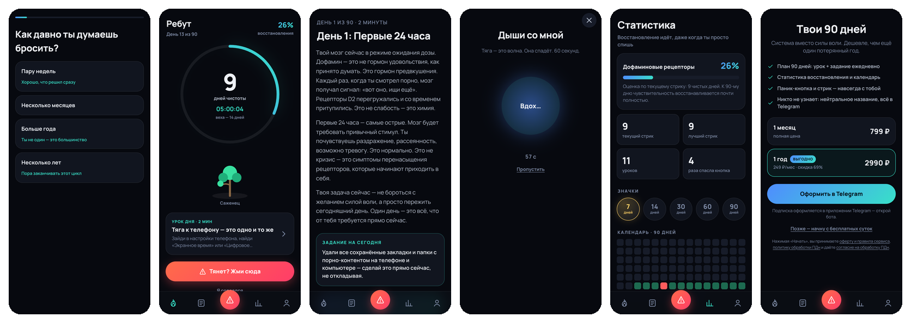
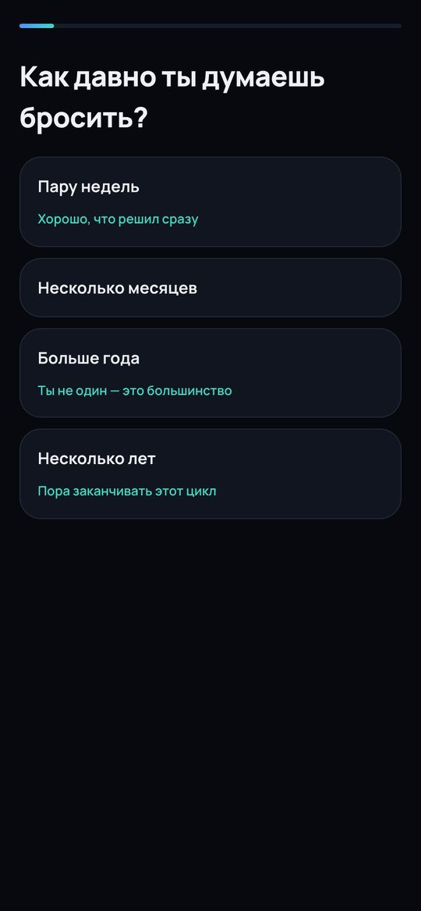
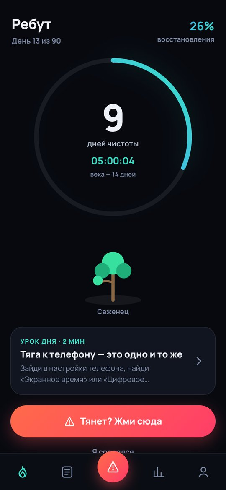
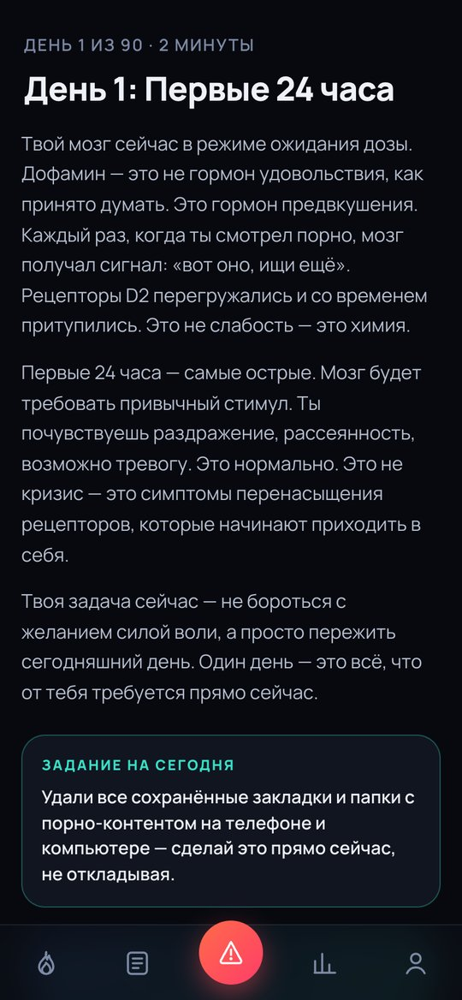
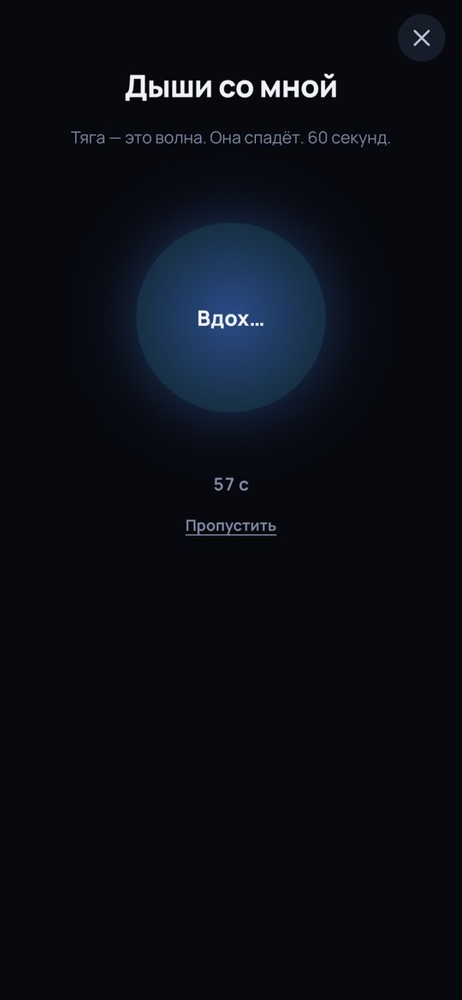
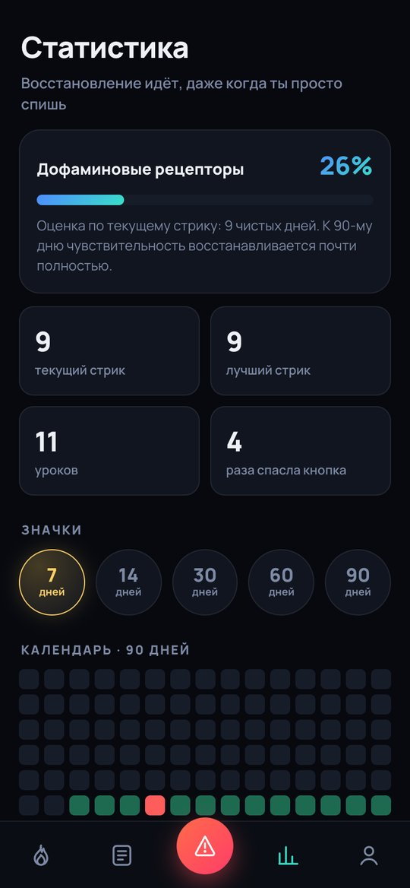
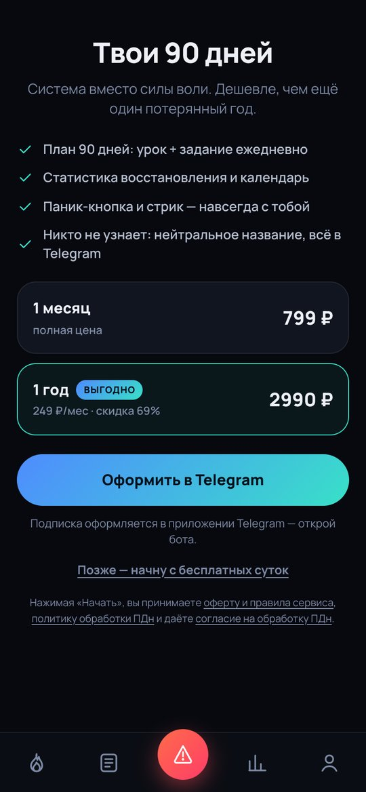
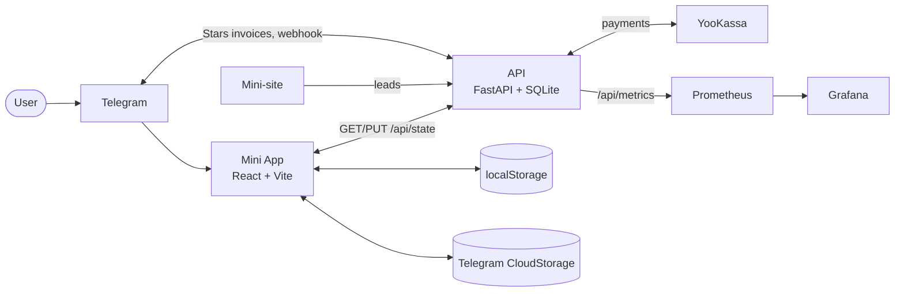
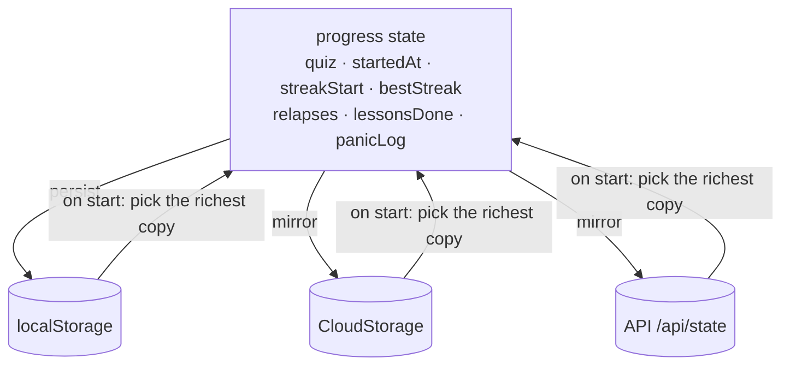
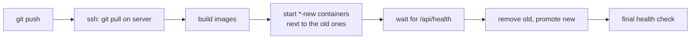

# Reboot (quitter) — 90-day dopamine reset in Telegram

A Telegram Mini App that helps people quit a compulsive habit with a structured **90-day program**: a streak counter, a lesson and a micro-task for every day, a panic button for urges, a relapse calendar, badges and recovery statistics. Onboarding is a short quiz followed by a paywall; payments go through Telegram Stars or YooKassa.



## Contents

- [Screens](#screens)
- [Features](#features)
- [Architecture](#architecture)
- [Data and sync](#data-and-sync)
- [Access and payments](#access-and-payments)
- [API](#api)
- [Monitoring](#monitoring)
- [Getting started](#getting-started)
- [Deployment](#deployment)

## Screens

| Onboarding quiz | Today | Lesson of the day |
|:---:|:---:|:---:|
|  |  |  |
| **Panic button** | **Stats** | **Paywall** |
|  |  |  |

## Features

| Feature | Description |
|---|---|
| **Streak** | Live counter of clean days, hours and minutes, with a growing "tree" as a visual metaphor. |
| **90-day plan** | 90 short lessons (about 2 minutes each) on neuroplasticity, triggers and habits, each with a concrete task for the day. |
| **Panic button** | Always one tap away: a 60-second guided breathing exercise to ride out an urge. |
| **Recovery stats** | Estimated "dopamine receptor" recovery based on the current streak, best streak, lessons completed, times the panic button helped. |
| **Badges** | 7, 14, 30, 60 and 90 days. |
| **Relapse calendar** | 90-day grid showing clean days and relapses; relapses are recorded, never erased. |
| **Onboarding quiz** | A few questions that personalise the plan and lead into the paywall. |
| **Privacy** | Neutral app name in Telegram, personal-data consent flow with revocation. |

## Architecture



| Part | Technology |
|---|---|
| Mini App (`miniapp/`) | React, Vite, React Router (hash), dark theme |
| API (`api/`) | FastAPI, SQLite, prometheus-client |
| Infra | Docker, nginx, Caddy, Prometheus, Grafana |

## Data and sync

`localStorage` is the source of truth; Telegram CloudStorage and the backend are mirrors that make progress portable between devices. On start the app pulls all copies and keeps the most complete one.



## Access and payments

| Tier | What is available |
|---|---|
| Trial (24 hours) | Everything |
| Free | Streak and panic button |
| Premium | Full 90-day plan and statistics |

| Plan | Price | Telegram Stars |
|---|---|---|
| 1 month | 799 ₽ | 500 ⭐ |
| 1 year | 2 990 ₽ | 1 870 ⭐ |

## API

| Method | Path | Purpose |
|---|---|---|
| `GET` | `/api/me` | user, trial and subscription state |
| `GET` / `PUT` | `/api/state` | progress sync |
| `POST` | `/api/invoice` | create a Telegram Stars invoice |
| `GET` | `/api/pay/methods` | available payment methods |
| `POST` | `/api/pay/yookassa`, `/api/pay/yookassa/check` | YooKassa payment and status |
| `POST` | `/api/yk-webhook` | YooKassa callback |
| `POST` | `/api/tg-webhook` | Telegram bot webhook |
| `POST` | `/api/consent/revoke` | revoke personal-data consent |
| `POST` | `/api/lead`, `GET /api/lead/status` | leads from the mini-site |
| `GET` | `/api/metrics`, `/api/health` | metrics and health check |

## Monitoring

The API exports Prometheus metrics with the `quitter_` prefix — HTTP requests and latency, payments, revenue, leads, active and revoked consents. A dedicated Grafana instance with provisioned dashboards lives in `deploy/grafana/`.

## Getting started

```bash
cd miniapp
npm install
npm run dev
```

Outside Telegram the app runs in local mode (no payments or sync).

API configuration (env file): `BOT_TOKEN`, `WEBHOOK_SECRET`, `BOT_USERNAME`, `BOT_URL`, `APP_URL`, `DOCS_URL`, `ADMIN_CHAT_ID`, `YOOKASSA_*`.

## Deployment



`scripts/deploy.sh` deploys strictly through git (it refuses to run with a dirty tree) and performs a blue-green swap: new containers start alongside the old ones and are promoted once their health check responds.

The architecture mirrors [StretcherMiniapp](https://github.com/Fortuneq/StretcherMiniapp).
